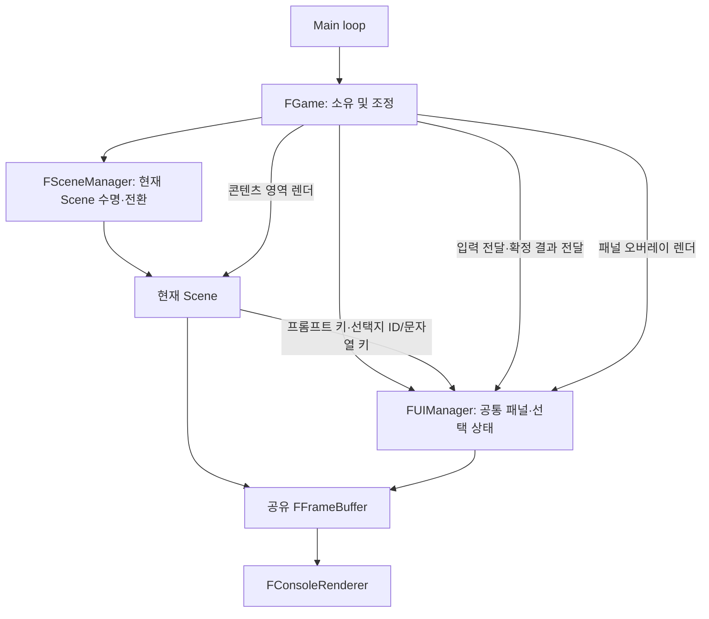

# 공통 UI Manager 및 고정 화면 설계안

> **과거 설계 보관:** 공통 하단 패널과 120×40/80×25·1920×1080 논의는 이전 상태다. 현재 승인된 132×43 Scene별 배치, Scene 소유 UI 객체, 36×36 Unicode 아트와 교체 가능한 입력 설계는 [007_Scene별UI객체및입력분리설계안.md](007_Scene별UI객체및입력분리설계안.md)를 우선한다. 아래 구현 기록은 보존하며 새 구조가 이미 런타임에 적용됐다는 뜻은 아니다.

> 상태: 공통 UI Manager와 마우스 선택·번호 기준 배치를 구현했다. Debug/Release × Win32/x64 빌드가 통과했다. 픽셀 단위 1920×1080 고정과 실제 실행 입력은 미검증이다.

## 1. 목표와 범위

- MainMenu, Town, Battle 등 모든 Scene에서 같은 위치·크기·테두리의 하단 선택 패널을 사용한다.
- Town의 ASCII 풍경과 Battle의 상태·캐릭터 표현은 패널 위 콘텐츠 영역에 배치한다.
- 선택 패널은 번호가 붙은 선택지를 표시한다. 마우스 커서를 올리면 해당 선택지를 강조하고 왼쪽 클릭으로 확정한다. 방향키와 Enter도 보조 조작으로 유지한다.
- 사용자 요구는 1920×1080 고정이다. 현재 구현은 콘솔 논리 셀 viewport에 패널을 배치하며 실제 클라이언트 영역을 1920×1080 픽셀로 강제하지 않는다.
- 구현 범위에는 공통 패널, Excel 기반 Scene 선택지, 마우스 hover/왼쪽 클릭과 키보드 보조 입력이 포함된다. 픽셀 단위 해상도 강제는 구현 범위에 포함되지 않았다.

## 2. 확인한 현재 상태와 제약

- `FSceneManager`가 현재 Scene을 단독 소유하며, `Main.cpp`가 입력·갱신·렌더 루프를 조정한다. 공통 선택 상태와 패널은 `FUIManager`가 보유한다.
- `FConsoleRenderer::BeginFrame()`은 현재 콘솔 viewport를 문자 열·행으로 읽어 프레임버퍼 크기를 정한다. viewport 조회가 실패하면 프레임 시작에 실패하며 임의의 80×25 fallback을 쓰지 않는다.
- `FFrameBuffer`는 한글·전각 문자를 표시 셀 폭에 맞춰 처리하고 콘솔에는 `WriteConsoleOutputW`를 사용한다. 실제 터미널 글꼴별 시각 결과는 실행 확인이 필요하다.
- Scene 자산의 화면 문구는 Excel Localization 키에서 가져온다. Scene txt에는 ASCII 그림과 비언어적 배치만 둔다.
- Microsoft의 콘솔 API 문서상 screen buffer와 viewport 크기는 문자 셀 좌표를 사용하며, 표시 가능한 크기는 글꼴·화면 크기 등의 제약을 받는다. 따라서 현재 콘솔 API가 1920×1080 픽셀을 보장한다고 전제하지 않는다. [콘솔 창과 화면 버퍼 크기](https://learn.microsoft.com/en-us/windows/console/window-and-screen-buffer-size), [GetConsoleScreenBufferInfo](https://learn.microsoft.com/en-us/windows/console/getconsolescreenbufferinfo)

## 3. 제안 구조와 책임

### 실행 루프

- `Main.cpp`가 `FSceneManager`와 `FUIManager`를 값으로 소유한다.
- 입력·갱신·렌더 순서를 조정한다. 입력 결과로 Scene 전환을 수행하고 현재 Scene이 파괴되기 전에 입력 처리가 끝나도록 한다.
- Singleton이나 모든 Manager의 공통 인터페이스는 사용하지 않는다.

### FSceneManager 및 Scene

- `FSceneManager`는 활성 Scene의 생성·수명·전환을 맡는다. UI 패널의 레이아웃이나 메뉴 커서는 소유하지 않는다.
- 각 Scene은 현재 맥락에 맞는 프롬프트 키와 선택지 목록을 제공한다. 각 선택지는 언어와 무관한 안정적인 `OptionId`와 Excel 문자열 키를 가진다.
- Scene은 선택 확정 후 `OptionId`를 받아 게임 규칙이나 Scene 전환을 결정한다. UI Manager가 전투·이동 등 게임 동작을 실행하지 않는다.
- Scene 렌더링은 공통 패널 영역을 침범하지 않고 상단 콘텐츠 영역만 사용한다.

### FUIManager

- 현재 패널 모델, 선택 인덱스, 표시 가능한 선택지 영역, 마우스 hover/왼쪽 클릭과 Up/Down/Enter 처리, 패널 렌더링을 맡는다.
- 문구 원본은 보유하지 않고 Scene 생성 데이터가 Excel 현지화 값을 선택지 모델에 전달한다. 경계선과 선택 표시 기호처럼 비언어적인 장식은 레이아웃 요소로 취급한다.
- 포인터가 선택지 슬롯으로 들어오면 그 항목이 강조되고, 유효한 왼쪽 클릭은 현재 `OptionId`를 확정한다. 위/아래 입력은 `OptionOrder` 순서로 항목을 선형 순회하며, 끝에서 반대쪽으로 이어지고 비활성 항목은 건너뛴다. Enter는 현재 `OptionId`를 확정한다. 선택 결과의 의미는 Scene이 해석한다. Esc는 현재 앱 루프에서 종료 입력이다.
- Scene 전환 시 이전 패널 상태를 지우고 새 Scene이 제공한 선택지로 초기화한다. 새 Scene에 선택 패널이 없으면 같은 영역을 비우되 패널 배경·틀 정책은 공통으로 유지한다.

## 4. 화면 좌표와 공통 하단 패널

다음은 **논리 문자 셀 기준의 초안**이며, 실제 콘솔 글꼴/픽셀 매핑 확인 전에는 확정 레이아웃으로 보지 않는다.

| 항목 | 제안 기준 |
|---|---:|
| 선호 논리 화면 | 120열 × 40행 |
| 최소 지원 논리 화면 | 80열 × 25행 |
| 선호 화면 패널 | 116열 × 9행 |
| 선호 화면 패널 위치 | 왼쪽 2열, 위쪽 31행 (0부터 시작, 하단 정렬) |
| 최소 화면 패널 | 76열 × 7행, 왼쪽 2열, 위쪽 18행 |
| 선택지 표시 | 행당 최대 4개, 2행 배치로 8개까지 표시. 초과분은 SceneType 데이터 정책에 따름 |

- 같은 viewport 프로필에서 패널의 좌표·너비·높이·테두리는 MainMenu/Town/Battle에서 동일하게 유지한다. 선택 문구 길이에 따라 패널 크기를 바꾸지 않는다. 120×40 선호 프로필과 80×25 최소 프로필 사이에서는 지정된 프로필별 geometry를 사용한다.
- MainMenu 메뉴도 동일한 하단 선택 패널로 옮긴다. `New Game`, `Continue`, `Settings`, `Credits`, `Exit`의 동작 지원 여부는 UI 레이아웃과 분리한다.
- Town은 기존 ASCII 풍경을 상단 영역에 배치하고, 이동·대화 등 선택지를 하단 패널에 제공한다. Battle은 전투 그림과 HP/MP 등 상태 정보를 상단 영역에 두고 공격·스킬·아이템·방어·도망 같은 행동을 같은 패널에 표시한다.
- 패널은 화면이 넓어져도 무한히 커지지 않고 최대 116셀 너비를 유지한다. 여분 공간은 좌우 여백으로 둔다. 콘텐츠 ASCII 아트는 픽셀 확대 없이 논리 셀 기준으로 중앙 배치하거나 잘라낸다.
- 긴 번역 문구의 줄바꿈·잘림·페이지 이동, 비활성 선택지의 표시, 포커스 표시 모양은 문자열 폭 처리를 확정한 뒤 UI 세부 규칙으로 정한다.
- 구현은 80×25 최소 프로필에 76×7 패널을, 120×40 선호 프로필에 116×9 패널을 사용한다. 이 논리 셀 프로필만으로 1920×1080 픽셀 창을 보장하지 않는다.

### 선택지 번호 및 배치

- 각 선택지는 `1.`, `2.`처럼 `OptionOrder` 번호를 접두어로 표시한다. 열 너비와 균등 간격은 문자열 길이가 아니라 번호가 시작하는 슬롯 좌표를 기준으로 계산한다.
- 한 행에 최대 4개를 배치한다. 2~4개면 한 행의 패널 안쪽 너비를 항목 수만큼 균등 분할하고 각 슬롯 시작점에 번호와 문구를 왼쪽 정렬한다. 따라서 2개는 `1.  2.`, 3개는 `1.  2.  3.`, 4개는 `1.  2.  3.  4.` 순으로 한 행에 놓인다.
- 5~8개는 행마다 최대 4개로 나눈다. 8개는 4개씩 두 행에 놓는다. 마지막 행의 슬롯도 해당 행의 항목 수를 기준으로 패널 너비에 균등 분배한다.
- 항목이 0개면 공통 패널 테두리만 표시한다. 한 슬롯의 문구가 길면 다른 슬롯을 밀지 않도록 슬롯 안에서 자르거나 줄인다. 표시 폭은 논리 셀 기준으로 계산한다.
- 마우스 위치가 선택지 슬롯에 들어오면 `OptionId`를 선택 상태로 바꾸고 강조 속성을 적용한다. 포인터가 패널 밖으로 나가면 선택 상태는 유지한다. 왼쪽 클릭은 현재 강조 선택지를 확정한다. 슬롯 사이 여백과 테두리 클릭은 아무 동작도 하지 않는다.
- Town 선택지는 `이동`, `가방`, `상점`, `휴식` 순으로 Scene.xlsx에서 읽는다. 방향키는 키보드 보조 조작으로 남기며 Enter로 확정한다. 스크롤 정책은 Scene 데이터에 두고, 초과 항목을 위한 전용 InputManager는 후속 범위다.

## 5. 1920×1080 해석 및 화면 크기 정책

현재 구조에서는 픽셀 단위의 고정 화면과 콘솔 셀 기반 렌더링을 구분해야 한다.

1. **현재 구현:** 1920×1080은 사용자 목표 해상도로 기록했으며, 120×40 선호 셀 프로필을 사용한다. 이는 셀 크기 약 16×27픽셀이라는 단순 계산에 해당하지만, 콘솔에서 그 물리 매핑을 보장하지 않는다. 실제 실행 환경에서 폰트, DPI 배율, 터미널 여백, 표시 영역을 측정해야 한다.
2. **논리 화면 프로필:** 구현은 120×40을 선호 크기로, 80×25를 최소 지원 크기로 사용한다. 실제 viewport가 선호 크기보다 크면 최대 패널 폭을 유지하며 가운데 배치하고, 선호 크기보다 작지만 최소 크기 이상이면 작은 프로필의 패널 geometry를 사용한다. 최소 크기보다 작으면 크기 부족 문구를 표시한다. 이 셀 크기 정책은 1920×1080 픽셀 창을 보장하지 않는다.
3. **엄격한 픽셀 고정 요구:** 창의 클라이언트 영역을 어떤 지원 환경에서도 정확히 1920×1080 픽셀로 보장해야 한다면 콘솔 렌더러의 셀 기반 창 크기 조절만으로는 충족하기 어렵다. 이 경우 콘솔 유지 여부와 전용 그래픽 창/렌더러로의 전환을 구현 전에 결정해야 한다. 이는 현재 설계 초안의 범위를 넘는 선택이며 자동으로 채택하지 않는다.
4. 앱은 Windows 바탕 화면 해상도나 DPI 설정을 변경하지 않는다. 최소 viewport 미만에서는 Excel Localization의 크기 부족 문구를 표시한다.
5. 런타임 viewport 크기가 바뀌면 120×40 또는 80×25 중 맞는 프로필을 고르고, Scene과 선택 인덱스는 유지한다. 최소 크기보다 작으면 정의된 크기 부족 UI/중단 정책을 따른다. 모든 Scene은 같은 프로필과 동일한 viewport 정보를 공유한다.
6. 창 크기 변경이 감지되면 전체 프레임을 다시 그려 이전 프레임 잔상을 지운다. ASCII 아트는 논리 셀 기준으로 중앙 배치 또는 잘라내기를 적용한다.

## 6. 구현 상태와 미결정 사항

다음 항목은 추가 실행 환경 확인이나 후속 구현이 필요하다.

1. `1920×1080`이 **실제 프로그램 표시 영역의 픽셀 크기**인지, 1920×1080 모니터를 목표로 한 **논리 레이아웃 기준**인지 확정한다.
2. 콘솔 유지/별도 그래픽 창 중 출력 호스트를 선택한다. 콘솔을 유지한다면 지원할 터미널, 글꼴, 폰트 크기, DPI 정책과 최소 표시 셀 수를 정한다.
3. 120×40 및 80×25 프로필과 각각의 패널 geometry를 실제 콘솔에서 시각 확인한다. 물리 픽셀과 논리 셀 간 매핑은 환경별로 다르다.
4. 한글·전각 문자의 셀 폭 처리를 구현했지만 실제 터미널 글꼴에서 테두리·잘림을 확인하지 않았다.
5. UI 데이터 계약은 `OptionId`, `OptionOrder`, 문자열 키, 선택 가능 상태를 사용하며 마우스 hitbox는 렌더 슬롯과 같은 계산 함수를 공유한다. 현재 Town/BattleField 데이터의 선택 액션은 아직 구현되지 않았다.
6. 실제 Scene 화면에서 모든 선택지 수, 영어·한국어 긴 문구와 resize 동작을 수동 확인한다.

## 7. 검토용 완료 기준

구현 명령을 받았을 때 아래 조건으로 설계가 동작하는지 확인할 수 있다.

- 1920×1080 목표 디스플레이와 실제 셀 그리드가 구분되어 기록된다. 120×40 및 80×25 지원 프로필에서 표시 결과를 확인하고, 픽셀 크기 보장 범위를 문서/실행 결과가 일치하게 설명한다.
- MainMenu, Town, Battle에서 패널의 왼쪽·위쪽 좌표, 폭, 높이, 테두리가 동일하다. Scene 전환 시에도 패널 위치와 선택 인덱스 초기화 규칙이 일관된다.
- Up/Down은 정한 순환/경계 규칙을 따르고 Enter는 선택된 `OptionId` 하나만 Scene에 전달한다. 포인터 hover는 렌더 슬롯과 동일한 hitbox에서만 선택을 변경하며, 왼쪽 클릭은 현재 선택된 `OptionId` 하나만 Scene에 전달한다. UI Manager는 게임 동작을 직접 실행하지 않는다.
- 선택지 2·3·4개는 한 행에 균등 배치하고, 8개는 4개씩 두 행에 배치한다. 번호 접두어 `1.` 등의 시작점이 슬롯마다 정렬된다.
- 선택지 0개·1개·최대 표시 개수·초과 개수, 사용 불가 항목, 긴 한국어/영어 문구를 확인한다. 한글·전각 문자가 테두리나 이웃 글자를 깨뜨리지 않는다.
- viewport가 기준보다 작거나 실행 중 바뀌어도 정상 Scene이 조용히 잘리거나 이전 프레임이 남지 않는다. 확정된 안내/차단 정책을 따른다.
- 크기 설정/조회가 실패했을 때 현재의 80×25 fallback으로 조용히 진행하지 않고 진단 또는 정의된 복구 UI를 제공한다.

## 8. 후속 작업 후보

현재 구현 뒤 다음 순서가 적절하다.

1. 픽셀/콘솔 해석과 120×40 선호 및 80×25 최소 viewport를 확정하고 실제 기준 환경에서 측정한다.
2. 한글·전각 셀 폭 처리를 포함해 프레임버퍼 좌표 계약을 먼저 보완한다.
3. 실제 실행 화면에서 MainMenu와 Town의 hover/click 및 키보드 입력을 확인한다.
4. BattleField 콘텐츠와 액션을 연결하되 같은 패널 레이아웃을 사용한다.
5. 픽셀 단위로 정확한 1920×1080 표시가 요구되면 콘솔 셀 UI만으로 충족되는지 기준 환경에서 판정하고 필요 시 별도 창 기술을 결정한다.

